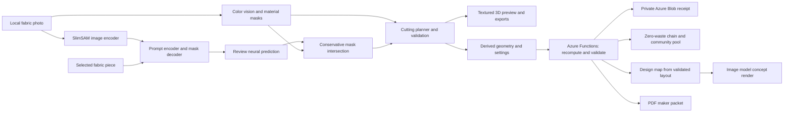

# ReThread

### Give every scrap a second story.

Turn a photograph of fabric offcuts into a material inventory, a validated cutting layout, and a textured 3D design. ReThread helps sewing students, repair cafés, and upcycling workshops answer: **“What can I make from what I already have?”**

[](https://github.com/Siddhanthkjain2005/Banana_Hacks/actions/workflows/ci.yml)

**[Open the live Azure demo](https://salmon-stone-073245e00.4.azurestaticapps.net/)** · [Submission fields](docs/SUBMISSION-FIELDS.md) · [Project story](docs/DEVPOST.md)


Built for **Banana Hacks** by **Oddment Guild**: Siddhanth K Jain, Adithya P, Kamma Rohan, and Dinesh Kulkarni.

## What you can do

| Feature | Working behavior |
| --- | --- |
| Real neural vision | SlimSAM’s pretrained image encoder and prompt/mask decoder run locally. Review the predicted foreground, then apply a conservative boundary refinement. |
| Material inventory | Per-image CIELAB clustering, background estimation, morphology, and connected components measure separate scraps. |
| Shape-aware planning | Generate tote, pouch, or cushion layouts with mask containment, non-overlap checks, seam allowance, size, and rotation constraints. |
| Product comparisons | Compare actual layouts under the same constraints; complete plans rank first, followed by measured utilization. |
| Interactive 3D | Preview textures from the source photo; rotate, zoom, inspect exploded assembly and wireframes. |
| Maker controls | Exclude unsuitable scraps, restore them, change design priorities, and save collections locally. |
| Physical exports | Download SVG cutting sheets with a 10 cm scale check, JSON reports, TXT sewing guides, and PNG concepts. |
| Private Azure backend | Recompute geometry, save durable receipts, recover interrupted saves without duplicate records, and retrieve or delete using a private capability. |
| Layout-conditioned concept renders | The API rasterizes the validated cutting plan into a design map of measured colours and seams. With an image model configured, that map conditions the render. Photos and masks are never sent. |
| Zero-waste project chain | After the first product, plan further complete products from the exact leftover offcuts. On the Denim repair sample, a tote plus a pouch raise fabric use from 64.5% to 76.6%. |
| Community fabric pool | Combine scraps from up to eight donors' photos, each with its own calibration. Shows who contributed what and whether pooling made the project possible. |
| Colour-aware sewing layout | Swap interchangeable cuts between grid slots to maximize perceptual contrast. On Denim repair, same-fabric neighbours drop from 7 to 0. |
| Printable maker packet | A4 or Letter PDF with calibration bar, cut list, per-scrap cutting diagrams, sewing layout, and steps, for repair cafés and classrooms. |
| Read-only sharing and impact | Owners mint viewer links that cannot delete. Impact estimates cite their assumptions. Every route is described in OpenAPI 3.1. |

The v1.2 chains, pools, colour arrangements, PDF packets, and sharing capabilities are available through the [API](api/README.md). The studio exposes photo analysis, neural review, 3D planning, its existing exports, and private receipts. External image generation is an optional provider integration.

## Try it in a minute

1. Open the demo and select **Browse samples**, or upload a top-down photograph of separated scraps.
2. Enter **Photo width** for calibration and select **Analyze & design**.
3. Select a piece in the photo or material library. Choose **AI refine selected fabric**, review the green neural prediction, and apply it.
4. Explore products and **Find my best fit**, then inspect **Cutting plan** and the 3D controls.
5. Use **Export** or **Cloud verify & save → Saved plans → View receipt**.

All six examples are synthetic: three ImageGen photos and three procedural illustrations. Their scale is illustrative. Your fabric photographs remain in the browser; cloud saving sends derived masks, colors, calibration, and design settings.

## Architecture



[Architecture and model details](docs/ARCHITECTURE.md) · [API reference](api/README.md)

## Run locally

Use **Node.js 20 or newer**.

```bash
git clone https://github.com/Siddhanthkjain2005/Banana_Hacks.git
cd Banana_Hacks
npm ci
npm start
```

Open the printed localhost URL. The static studio, neural runtime, and model weights are included. No inference API key is required. `npm start` serves only the static studio.

```bash
npm ci --prefix api       # install Azure persistence dependencies
npm run dev               # studio + full API locally, receipts stored in .rethread-data/
npm run demo              # run every backend feature on the bundled samples → demo-output/
npm test                  # 58 geometry, model-integrity, backend, and feature tests
npm run sync:api          # synchronize the Azure engine after editing browser core
```

Deploy `dist/` and `api/` together on Azure Static Web Apps. Configure `STORAGE_CONNECTION_STRING` and `RETHREAD_ALLOWED_ORIGIN` in Azure settings. To enable AI concept renders, also set `RETHREAD_IMAGE_API_KEY`, plus `RETHREAD_IMAGE_BASE_URL` and `RETHREAD_IMAGE_MODEL` for Azure OpenAI. Secrets stay outside source control. See the [backend setup](api/README.md).

## Validation

**58 tests pass.** They cover real mask containment, cut overlap, calibration, incomplete layouts, neural refinement invariants, model checksums, capability access, expiry, bounded requests, interrupted-write recovery, and concurrent duplicate prevention. Version 1.2 tests add:
- exact leftover-mask erosion and cross-project validation for chains;
- pooled plans that no single donor can complete;
- permutation-only colour arrangement;
- well-formed PDF packets with a calibrated 100 mm bar;
- design maps drawn from measured colours;
- mocked image-provider auth, privacy, error mapping, and deadlines through response-body decoding;
- read-only share capabilities;
- OpenAPI coverage, security headers, and structured logs.

CI also runs the end-to-end demo on the bundled samples.

Public Azure checks passed storage readiness, durable save, identical-request replay, changed-input rejection, private retrieval, wrong-key rejection, and deletion. Real browser inference produced a neural mask, updated material area, recalculated a complete 26-cut plan, and saved the result privately. [Verification details](docs/VERIFICATION.md).

The deployed v1.2 API also passed the sample demo for planning, leftover chains, pooled fabric, design maps, A4/Letter packets, and read-only sharing. Viewer deletion returns 403; owner deletion succeeds. External image generation is not configured on this deployment.

## Repository guide

| Path | Purpose |
| --- | --- |
| `dist/` | Complete browser app, vendored runtimes, samples, and pinned neural weights. |
| `api/` | Azure Functions service: validation, chain, pool, concept, packet, and storage modules, plus deployable copies of the shared planner. |
| `tests/` | Automated vision, neural, recommendation, and persistence checks. |
| `scripts/` | Synchronization of shared browser and server geometry, and the end-to-end API demo. |
| `docs/` | Architecture, verified screenshots, project story, and recording script. |
| `.github/workflows/` | Automated Node.js 20 checks on pushes and pull requests. |

## Scope and credits

Physical dimensions depend on entered scene width and photograph quality. Review fabric condition, grain, stretch, and scale before cutting. SlimSAM is a general segmentation model; the app does not identify textile composition or prove sewing suitability. Utilization is a geometric estimate, and the nesting heuristic does not guarantee global optimality.

Three.js supplies rendering; SlimSAM, Transformers.js, and ONNX Runtime supply neural inference; Azure SDK supplies storage. Codex and Claude assisted development, and ImageGen supplied three labeled samples. Model revisions, file hashes, asset prompts, and third-party license notices are included. [Credits and licenses](THIRD_PARTY_NOTICES.md).
