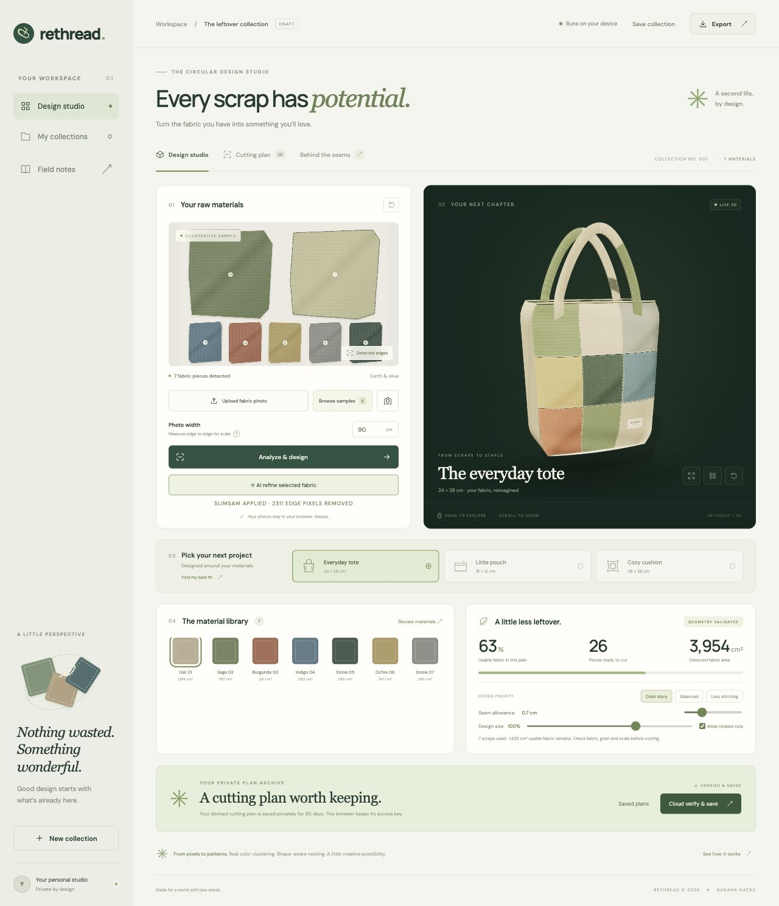
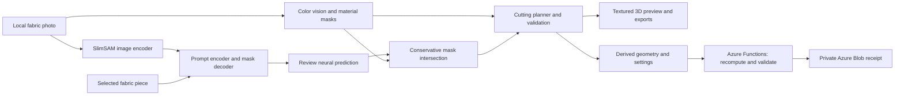

# ReThread

### Give every scrap a second story.

Turn a photograph of fabric offcuts into a material inventory, a validated cutting layout, and a textured 3D design. ReThread helps sewing students, repair cafés, and upcycling workshops answer: **“What can I make from what I already have?”**

[](https://github.com/Siddhanthkjain2005/Banana_Hacks/actions/workflows/ci.yml)

**[Open the live Azure demo](https://salmon-stone-073245e00.4.azurestaticapps.net/)** · [Project story](docs/DEVPOST.md) · [Three-minute video script](docs/VIDEO-SCRIPT-3MIN.md)



Built for **Banana Hacks** by **Oddment Guild**: Siddhanth K Jain, Adithya P, Kamma Rohan, and Dinesh Kulkarni.

## What you can do

| Feature | Working behavior |
| --- | --- |
| Real neural vision | SlimSAM’s pretrained image encoder and prompt/mask decoder run locally. Review the predicted foreground, then apply a conservative boundary refinement. |
| Material inventory | Per-image CIELAB clustering, background estimation, morphology, and connected components measure separate scraps. |
| Shape-aware planning | Generate tote, pouch, or cushion layouts with mask containment, non-overlap checks, seam allowance, size, and rotation constraints. |
| Product comparisons | Compare actual layouts under the same constraints; complete plans rank first, followed by measured utilization. |
| Interactive 3D | Preview textures from the source photo; rotate, zoom, inspect exploded assembly and wireframes. |
| Maker controls | Exclude unsuitable scraps, restore them, change design priorities, and save collections locally. |
| Physical exports | Download SVG cutting sheets with a 10 cm scale check, JSON reports, TXT sewing guides, and PNG concepts. |
| Private Azure backend | Recompute geometry, save durable receipts, recover interrupted saves without duplicate records, and retrieve or delete using a private capability. |

## Try it in a minute

1. Open the demo and select **Browse samples**, or upload a top-down photograph of separated scraps.
2. Enter **Photo width** for calibration and select **Analyze & design**.
3. Select a piece in the photo or material library. Choose **AI refine selected fabric**, review the green neural prediction, and apply it.
4. Explore products and **Find my best fit**, then inspect **Cutting plan** and the 3D controls.
5. Use **Export** or **Cloud verify & save → Saved plans → View receipt**.

All six examples are synthetic: three ImageGen photos and three procedural illustrations. Their scale is illustrative. Your fabric photographs remain in the browser; cloud saving sends derived masks, colors, calibration, and design settings.

## Architecture



[Architecture and model details](docs/ARCHITECTURE.md) · [API reference](api/README.md)

## Run locally

Use **Node.js 20 or newer**.

```bash
git clone https://github.com/Siddhanthkjain2005/Banana_Hacks.git
cd Banana_Hacks
npm ci
npm start
```

Open the printed localhost URL. The static studio, neural runtime, and model weights are included. No inference API key is required. The local static server does not provide Azure cloud endpoints.

```bash
npm test                 # 38 geometry, model-integrity, and backend tests
npm run sync:api          # synchronize the Azure engine after editing browser core
npm ci --prefix api       # install Azure persistence dependencies
```

Deploy `dist/` and `api/` together on Azure Static Web Apps. Configure `STORAGE_CONNECTION_STRING` and `RETHREAD_ALLOWED_ORIGIN` in Azure settings. Secrets stay outside source control. See the [backend setup](api/README.md).

## Validation

**38 tests pass.** They cover real mask containment, cut overlap, calibration, incomplete layouts, neural refinement invariants, model checksums, capability access, expiry, bounded requests, interrupted-write recovery, and concurrent duplicate prevention.

Public Azure checks passed storage readiness, durable save, identical-request replay, changed-input rejection, private retrieval, wrong-key rejection, and deletion. Real browser inference produced a neural mask, updated material area, recalculated a complete 26-cut plan, and saved the result privately. [Verification details](docs/VERIFICATION.md).

## Repository guide

| Path | Purpose |
| --- | --- |
| `dist/` | Complete browser app, vendored runtimes, samples, and pinned neural weights. |
| `api/` | Azure Functions service and deployable copies of the shared planner. |
| `tests/` | Automated vision, neural, recommendation, and persistence checks. |
| `scripts/` | Synchronization of shared browser and server geometry. |
| `docs/` | Architecture, verified screenshots, project story, and recording script. |
| `.github/workflows/` | Automated Node.js 20 checks on pushes and pull requests. |

## Scope and credits

Physical dimensions depend on entered scene width and photograph quality. Review fabric condition, grain, stretch, and scale before cutting. SlimSAM is a general segmentation model; the app does not identify textile composition or prove sewing suitability. Utilization is a geometric estimate, and the nesting heuristic does not guarantee global optimality.

Three.js supplies rendering; SlimSAM, Transformers.js, and ONNX Runtime supply neural inference; Azure SDK supplies storage. Codex assisted development, and ImageGen supplied three labeled samples. Model revisions, file hashes, asset prompts, and third-party license notices are included. [Credits and licenses](THIRD_PARTY_NOTICES.md).
