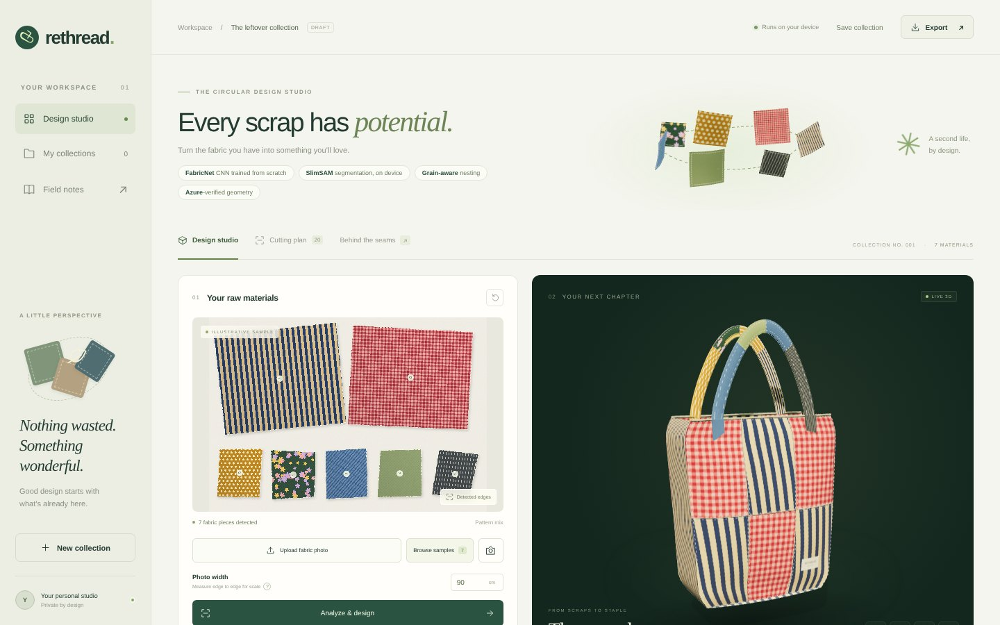
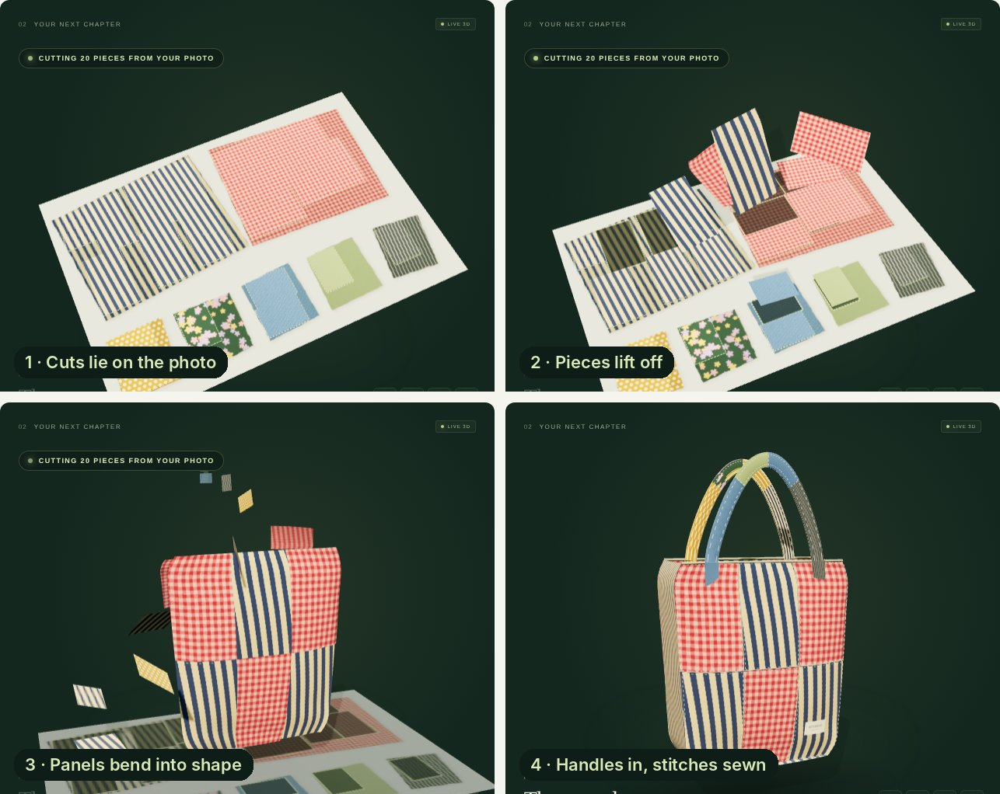
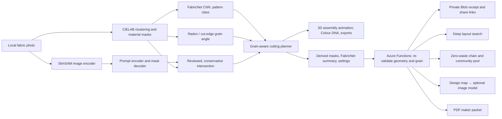

# ReThread

### Give every scrap a second story.

Turn a photograph of fabric offcuts into a material inventory, a grain-aware cutting layout, and a textured 3D design — then watch the real cuts lift off your photo and sew themselves into the product. ReThread helps sewing students, repair cafés, and upcycling workshops answer: **“What can I make from what I already have?”**

[](https://github.com/Siddhanthkjain2005/Banana_Hacks/actions/workflows/ci.yml)

**[Open the live Azure demo](https://salmon-stone-073245e00.4.azurestaticapps.net/)** · [Submission fields](docs/SUBMISSION-FIELDS.md) · [Project story](docs/DEVPOST.md)



Built for **Banana Hacks** by **Oddment Guild**: Siddhanth K Jain, Adithya P, Kamma Rohan, and Dinesh Kulkarni.

## What's new in 1.3

| Feature | Working behavior |
| --- | --- |
| **FabricNet** (trained from scratch) | A 7,286-parameter CNN with hand-written forward/backward passes and Adam in JavaScript, trained on 108,000 synthesized textile patches. Classifies each scrap as solid, textured, stripe, check, dots, or print in a Web Worker. **96.3% on a fresh held-out synthetic set**; real-photo accuracy is not yet measured. [Model card](dist/models/fabricnet/fabricnet.json) |
| **Grain estimation** | Projection-profile (Radon) search over the pattern, or length-weighted cut-edge orientation, folded to (−45°, 45°]. Recovers synthetic stripe angles within 0.9°; reads −6.0°, +1.8°, +8.9° for Pattern mix pieces rotated −6°, +2°, +9°. |
| **Grain-aware cutting** | Directional stripes never rotate; fabric more than 7° off grain is used last; every cut carries its grain note. The server accepts the FabricNet summary and reproduces the same plan. |
| **3D assembly animation** | Each planned cut starts flat on the photo at its exact source pixels, lifts, turns, and morphs into its curved panel; sides and handles fly in; stitches sew themselves. Replays on every new plan. |
| **Colour DNA** | A rotating Three.js CIELAB point cloud of the photo's fabric pixels, with one sphere per scrap sized by area. |
| **Zero-waste lab** | The studio now runs the Azure routes: leftover chain, colour harmony (applied to the 3D model), deep layout search, server impact estimate, community pooling with a second photo, A4/Letter maker packets, design map, and read-only share links that open in the studio. |
| **Deep search API** | `POST /api/optimize`: seeded multi-start restarts of the validated engine within a time budget, ranked by completeness, cuts placed, largest reusable offcut, and scraps left whole. |
| **Enclosed motifs** | Light dots or gingham squares that match the background no longer punch holes in scraps; filled areas are flagged for inspection. |
| **Pattern mix sample** | A procedural showcase with stripes, gingham, dots, florals, denim, and a pinstripe, rendered with known rotations by `scripts/make-pattern-sample.mjs`. |



[FabricNet readout and Colour DNA](docs/screenshots/v13-fabricnet.jpg) · [Zero-waste lab](docs/screenshots/v13-lab.jpg) · [FabricNet model card](docs/screenshots/v13-model-card.jpg)

## Everything it does

| Feature | Working behavior |
| --- | --- |
| Real neural vision | FabricNet (ours) and SlimSAM's pretrained image encoder and prompt/mask decoder run locally. SlimSAM predictions are reviewed, then conservatively intersected with the measured mask. |
| Material inventory | Per-image CIELAB clustering, background estimation, morphology, connected components, and enclosed-motif filling measure separate scraps. |
| Shape-aware planning | Tote, pouch, or cushion layouts with mask containment, non-overlap checks, seam allowance, size, rotation, and grain constraints. |
| Product comparisons | Compare actual layouts under the same constraints; complete plans rank first, followed by measured utilization. |
| Interactive 3D | Assembly animation, textures from the source photo, rotate, zoom, exploded assembly, and wireframes. |
| Maker controls | Exclude unsuitable scraps, restore them, change design priorities, toggle grain rules, and save collections locally. |
| Physical exports | SVG cutting sheets with a 10 cm scale check, JSON reports with FabricNet results, TXT sewing guides, PNG concepts, and PDF maker packets. |
| Private Azure backend | Recompute geometry, save durable receipts, recover interrupted saves without duplicate records, and retrieve, share, or delete using private capabilities. |
| Zero-waste project chain | After the first product, plan further complete products from the exact leftover offcuts. On Pattern mix, a tote plus a pouch raise fabric use from 68.5% to 76.2%. |
| Community fabric pool | Combine scraps from up to eight photos, each with its own calibration; shows contributions and whether pooling made the project possible. |
| Colour-aware sewing layout | Swap interchangeable cuts between grid slots to maximize perceptual contrast; apply the result to the 3D model. |
| Layout-conditioned concept renders | The API rasterizes the validated cutting plan into a design map. With an image model configured, that map conditions the render. Photos and masks are never sent. |
| Read-only sharing and impact | Owners mint viewer links that open in the studio and cannot delete. Impact estimates cite their assumptions. Every route is described in OpenAPI 3.1. |

## Try it in a minute

1. Open the demo. The **Pattern mix** sample loads, FabricNet tags each scrap, and the pieces assemble into a tote. Use **Browse samples** for six more collections, or upload a top-down photo of separated scraps.
2. Enter **Photo width** for calibration and select **Analyze & design**.
3. Inspect **FabricNet readout** and **Colour DNA**. Toggle **Grain-aware (FabricNet)** to see stripes unlock rotation.
4. Select a piece and choose **AI refine selected fabric** for SlimSAM review.
5. Switch products, press ▶ to replay the assembly, and open **Cutting plan**.
6. Scroll to the **Zero-waste lab**: it runs on Azure automatically. Apply colour harmony, try the deep-search layout, pool with a donor photo, and download a maker packet.
7. **Cloud verify & save**, then **Copy read-only link** to share it.

All seven examples are synthetic: three ImageGen photos and four procedural illustrations. Their scale is illustrative. Your fabric photographs remain in the browser; cloud routes receive derived masks, colours, FabricNet summaries, calibration, and design settings.

## Architecture



[Architecture and model details](docs/ARCHITECTURE.md) · [API reference](api/README.md)

## Run locally

Use **Node.js 20 or newer**.

```bash
git clone https://github.com/Siddhanthkjain2005/Banana_Hacks.git
cd Banana_Hacks
npm ci
npm start
```

Open the printed localhost URL. The static studio, neural runtime, and model weights are included. No inference API key is required. `npm start` serves only the static studio.

```bash
npm ci --prefix api       # install Azure persistence dependencies
npm run dev               # studio + full API locally, receipts stored in .rethread-data/
npm run demo              # run every backend feature on the bundled samples → demo-output/
npm test                  # 72 geometry, FabricNet, grain, model-integrity, backend, and feature tests
npm run sync:api          # synchronize the Azure engine after editing browser core
npm run train:fabricnet   # retrain FabricNet from scratch (≈12 min on 2 CPU cores) → dist/models/fabricnet/
npm run sample:patterns   # re-render the Pattern mix sample with its known rotations
```

Deploy `dist/` and `api/` together on Azure Static Web Apps. Configure `STORAGE_CONNECTION_STRING` and `RETHREAD_ALLOWED_ORIGIN` in Azure settings. To enable AI concept renders, also set `RETHREAD_IMAGE_API_KEY`, plus `RETHREAD_IMAGE_BASE_URL` and `RETHREAD_IMAGE_MODEL` for Azure OpenAI. Secrets stay outside source control. See the [backend setup](api/README.md).

## Validation

**72 tests pass.** They cover real mask containment, cut overlap, calibration, incomplete layouts, neural refinement invariants, model checksums, capability access, expiry, bounded requests, interrupted-write recovery, and concurrent duplicate prevention. Version 1.2 added leftover chains, pools, colour arrangement, PDF packets, design maps, image-provider safety, sharing, and OpenAPI coverage. Version 1.3 adds:

- FabricNet weight SHA-256, architecture, and exact parity between the training forward pass and browser inference;
- held-out accuracy on freshly synthesized patches (≥ 90% required; 96.3% recorded);
- grain recovery within 1.5° across stripe angles and periods, and cut-edge orientation within 1°;
- Pattern mix classification and its known rotations;
- grain-aware planning (no rotated cuts from directional fabric, consistent off-grain counts) and identical server re-planning with FabricNet summaries, plus strict rejection of malformed ones;
- deep-search determinism, grid preservation, never-worse results, route bounds, exact reproduction of applied layouts in cloud receipts, and grain-aware product comparisons.

The live Azure v1.3 API and browser lab have been verified, including selected-layout reproduction, private saving, and viewer restrictions. CI also runs the end-to-end demo on the bundled samples. [Verification details](docs/VERIFICATION.md).

## Repository guide

| Path | Purpose |
| --- | --- |
| `dist/` | Complete browser app, vendored runtimes, samples, SlimSAM and FabricNet weights. `fabric-intel.js` (FabricNet inference and grain), `studio.js` (3D and assembly animation), `dna.js`, `hero.js`, `lab.js` (Zero-waste lab and sharing). |
| `api/` | Azure Functions service: validation, chain, pool, optimize, concept, packet, and storage modules, plus deployable copies of the shared planner. |
| `scripts/` | FabricNet training (`train-fabricnet.mjs`, `lib/cnn.mjs`, `lib/texture-synth.mjs`), the Pattern mix renderer, engine synchronization, and the end-to-end API demo. |
| `tests/` | Vision, FabricNet, neural, recommendation, persistence, and feature checks. |
| `docs/` | Architecture, verified screenshots, project story, and recording script. |
| `.github/workflows/` | Automated Node.js 20 checks on pushes and pull requests. |

## Scope and credits

Physical dimensions depend on entered scene width and photograph quality. Review fabric condition, grain, stretch, and scale before cutting. FabricNet was trained only on synthetic textures and recognises visual pattern, not fibre content or strength; its accuracy on real photographs has not been measured. SlimSAM is a general segmentation model. Utilization is a geometric estimate, and neither the greedy planner nor the deep search guarantees global optimality.

Three.js supplies rendering; SlimSAM, Transformers.js, and ONNX Runtime supply pretrained segmentation; FabricNet, its training code, and its data generator are our own; Azure SDK supplies storage. AI coding assistants helped development, and ImageGen supplied three labeled samples. Model revisions, file hashes, asset prompts, and third-party license notices are included. [Credits and licenses](THIRD_PARTY_NOTICES.md).
